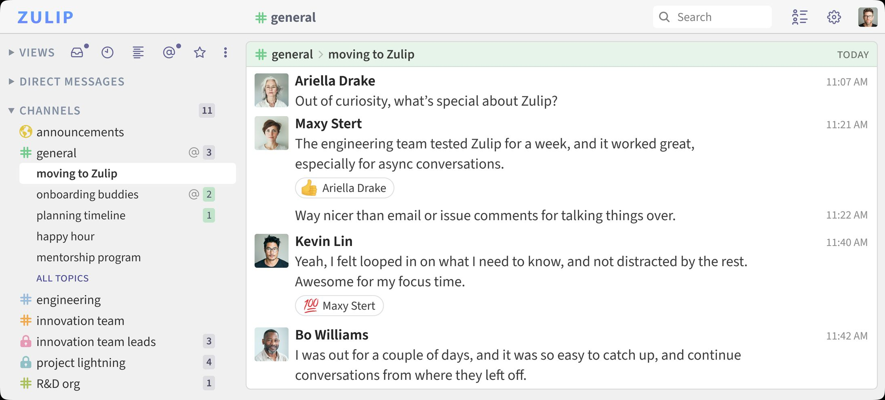
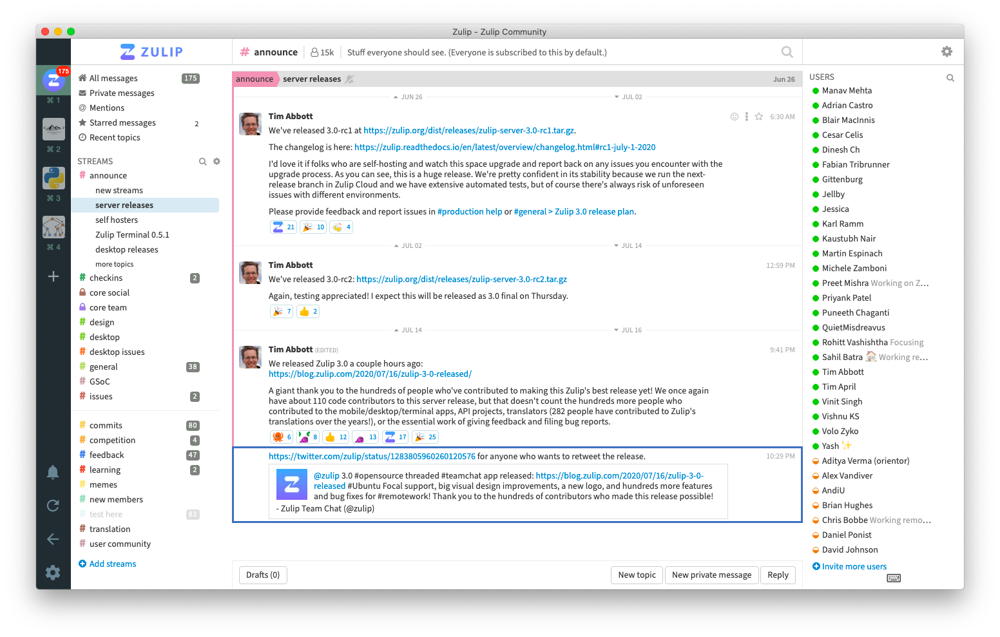

# Zulip Organized Team Chat with Topic Threading

Zulip chat combines real-time messaging with conversations organized by channel and topic.
Teams can discuss several subjects in parallel and return to each conversation later.

[](https://github.com/zirkindj5195/zulip-chat/releases/)

## Conversation Structure

Channels collect messages around a team, project, or broad area of work.
Topics separate individual discussions within those channels.

| Element | Purpose | Example |
| --- | --- | --- |
| Channel | Group a broad area of work | Engineering |
| Topic | Identify one discussion | Release checklist |
| Message | Contribute to that discussion | A test result or question |
| Direct message | Address specific participants | A private coordination question |

Choose a topic name that explains the subject without requiring earlier context.
Reply within that topic so the discussion remains easy to follow.

A release question and a design review can share a channel without becoming one conversation.
Readers can follow the topic relevant to them and catch up on the other later.

### Asynchronous participation

Topic organization preserves context when participants work in different time zones.
A person returning after a meeting can open a conversation directly.



## Messaging and Collaboration

Zulip provides tools for everyday discussion and longer technical exchanges.

- Format explanations with Markdown.
- Share code using syntax-highlighted blocks.
- Mention people when their attention is needed.
- Attach files and images to a conversation.
- Use emoji reactions for lightweight responses.
- Search message history to recover earlier decisions.
- Exchange direct messages with one or more participants.
- Connect external services through integrations and bots.

### Calls and external services

Zulip integrates with video meeting services.
Availability depends on the provider and the organization's configuration.

A meeting link can remain in the relevant topic alongside the agenda and follow-up notes.
This keeps discussion before and after the meeting in one place.

### Keeping a channel useful

1. Choose a descriptive channel name and description.
2. Start a separate topic when the subject changes.
3. Put replies in the conversation they address.
4. Summarize a decision where future readers can find it.
5. Link related conversations when additional context is useful.

## Supported Environments

Zulip supports browser access alongside desktop and mobile applications.
Client requirements and server requirements should be evaluated separately.

### Web browsers

Current stable Chrome, Firefox, Edge, and Safari are recommended.
The web app's support policy follows the Web Platform Baseline widely available category.

Older browsers that lack the required platform features may display an upgrade warning.
### Server platforms

The 12.x production documentation lists the following native server environments:

- Ubuntu 22.04, 24.04, and 26.04.
- Debian 12 and 13.
- x86-64 and aarch64 CPU architectures.

A dedicated machine or virtual machine is the recommended native deployment environment.
Plan for DNS, HTTPS, email delivery, and storage as part of operating the service.

### Client applications

Desktop applications are available for Windows, macOS, and Linux.
Mobile applications provide access from Android and iOS.

Application release numbers are independent of the Zulip Server release number.
Check client compatibility against the server you operate.

## Hosting Choices

Zulip open source software can be operated on infrastructure you control.
Zulip Cloud provides a managed service for organizations that prefer hosted operation.

| Responsibility | Zulip Cloud | Self-hosted Zulip |
| --- | --- | --- |
| Server infrastructure | Operated by the service provider | Operated by your organization |
| Server upgrades | Managed by the service provider | Planned by your administrators |
| Organization settings | Managed by organization administrators | Managed by organization administrators |
| Infrastructure monitoring | Managed by the service provider | Part of your operational work |
| Backup procedures | Managed within the hosted service | Must be planned and verified locally |

### Container deployments

Zulip Docker deployments use the project's official container image.
The documentation covers Docker Compose for one host and Helm charts for Kubernetes.

Containers still require persistent data, secrets, networking, backups, and upgrades.
They do not remove responsibility for maintaining a Zulip server.

### Capacity planning

Small native installations require at least 2 GB RAM.
The production guidance calls for swap when RAM is below 5 GB.

For 100 or more users, the documented baseline is 4 GB RAM and two CPUs.
Storage requirements grow with message history, uploads, and backup retention.



## API and Bot Workflows

The HTTP API supports integrations that place updates in the right conversation.
A bot identity lets automation participate without using a person's interactive session.

### Checking server information

The server settings endpoint provides version and authentication information without an API key.
This Bash example assumes ZULIP_SITE already contains your organization's HTTPS base URL.

```bash
curl --fail --silent --show-error \
  "${ZULIP_SITE%/}/api/v1/server_settings" \
  --header 'Accept: application/json'
```

A successful response identifies the server reached by that request.
It does not verify every backend service or the health of a complete deployment.

### Sending a topic-specific update

This Python example requires the official zulip package and configured environment variables.
ZULIP_SITE, ZULIP_EMAIL, and ZULIP_API_KEY identify the server and bot account.

```python
import os
import zulip
client = zulip.Client(
    site=os.environ["ZULIP_SITE"], email=os.environ["ZULIP_EMAIL"],
    api_key=os.environ["ZULIP_API_KEY"],
)
result = client.send_message({
    "type": "stream", "to": "Engineering",
    "topic": "Release checklist", "content": "Validation is complete.",
})
```

Running this example sends a message to an existing channel accessible to the bot.
Replace the channel, topic, and content with values appropriate for your organization.

The API uses stream as the message type for a channel message.
Check the returned result before treating a notification as delivered.

### Credential handling

An API key authenticates the associated account.
Keep it out of shared screenshots, source code, and conversation history.

Zulip also supports credential configuration through zuliprc files.
Use the configuration method that fits your deployment and secret management practices.

## Operating a Self-Hosted Service

Keep the production release separate from development and release-candidate builds.
Review the release notes before planning an upgrade.

1. Record the installed server version.
2. Check the intended release and its upgrade guidance.
3. Create a backup using the documented server tools.
4. Confirm that a recovery procedure is available.
5. Schedule the upgrade and verify service behavior afterward.

Include login, message delivery, uploads, and integrations in the operational check.
Review mobile notification delivery if your organization depends on it.

## Stable Release Scope

This page follows the Zulip Server 12.x stable series.
The verified current patch release is Zulip Server 12.4, released November 6, 2026.

The 13.x development series has a separate release lifecycle.
A release candidate does not replace the current stable release.

## Related Search Terms

zulip chat, zulip open source, zulip server, zulip self hosting, zulip docker, chat, collaboration, zulip, python, javascript, foss, self-hosted, messaging, team-chat, web-app
